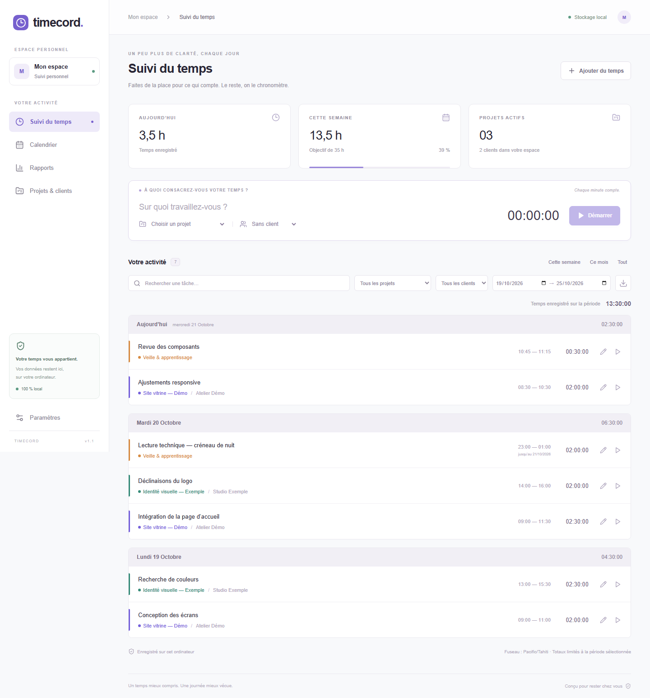
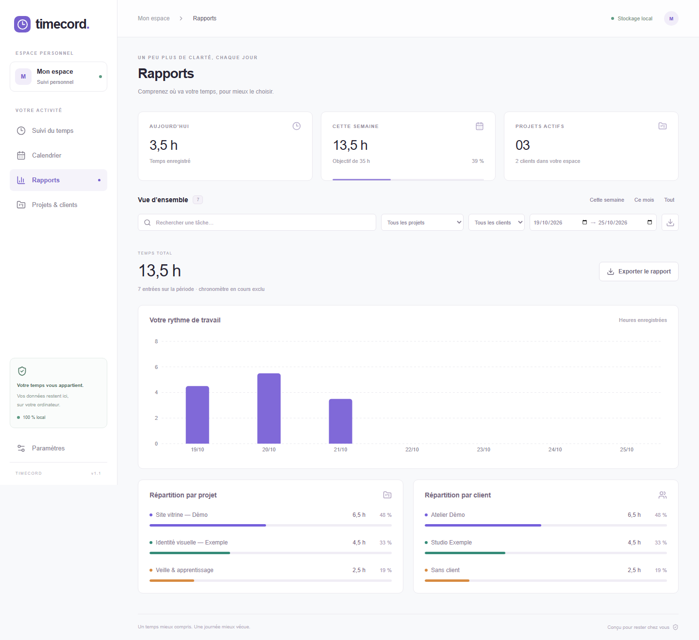
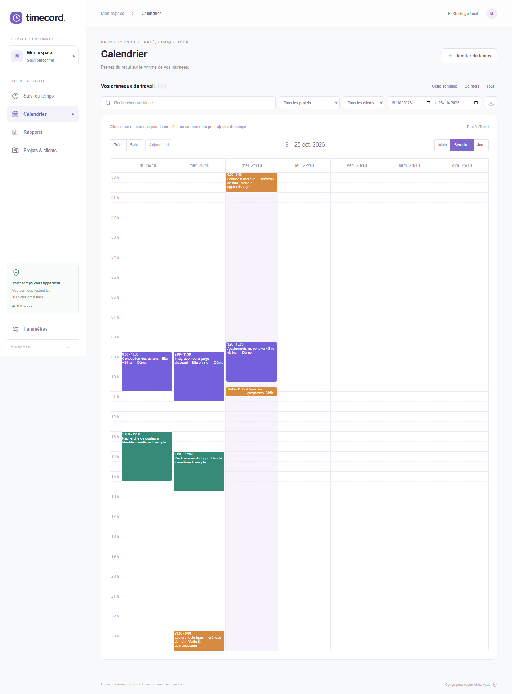

# Timecord

Timecord est une application **Windows de suivi du temps, en français**, avec une interface React et une base SQLite locale. Elle permet de chronométrer son travail, de corriger ses créneaux et de comprendre la répartition du temps par projet et par client, sans compte en ligne.

Le frontend Next.js est exporté en fichiers statiques puis embarqué dans **Tauri 2**. L’application installée fonctionne hors ligne et ne lance pas de serveur web. Ce dépôt contient les sources ; aucun installateur précompilé n’y est fourni.

## Aperçu

Les captures ci-dessous montrent l’interface dans **Chromium avec la communication Tauri simulée**. Tous les noms, projets et créneaux proviennent du [jeu de données fictif](tests/fixtures/portfolio.json). Ce ne sont pas des captures de l’application Windows native.



| Rapports                                                              | Calendrier                                                  |
| --------------------------------------------------------------------- | ----------------------------------------------------------- |
|  |  |

Pour régénérer ces images après une modification de l’interface :

```powershell
npm run build
npx playwright install chromium
npm run screenshots
```

Le script utilise un contexte de navigateur neuf et une horloge de démonstration. Il écrit uniquement les trois images de `docs/images/` et n’ouvre aucune base de données native.

## Fonctionnalités

- Chronomètre persistant : son instant de départ est enregistré et conservé après fermeture.
- Ajout, modification et suppression de créneaux ; passages à minuit avec une date de fin distincte.
- Projets colorés, clients facultatifs et archivage conservant l’historique.
- Recherche, filtres, périodes personnalisées, calendrier jour/semaine/mois et objectif hebdomadaire.
- Rapports par journée, projet et client ; export CSV de la sélection.
- Sauvegarde et restauration JSON avec validation et copie de récupération avant remplacement.
- Validation des références et des chevauchements côté Rust ; imports transactionnels et requêtes SQL paramétrées.

## Démarrer sous Windows

Environnement de référence utilisé pour les contrôles locaux et configuré pour la CI :

| Prérequis     | Version / configuration                                                                                   |
| ------------- | --------------------------------------------------------------------------------------------------------- |
| Système cible | Windows x64 ; environnement de développement Windows 10/11                                                |
| Node.js       | **24.16.0**, indiqué dans `.node-version`                                                                 |
| npm           | **11.13.0** utilisé pour l’installation avec `npm ci`                                                     |
| Rust          | **1.99.1**, édition 2024, cible `x86_64-pc-windows-msvc` ; fixé dans `rust-toolchain.toml` avec Clippy    |
| Outils natifs | Microsoft Visual Studio Build Tools 2022, charge de travail **Développement Desktop en C++**, SDK Windows |
| Rendu natif   | Microsoft Edge WebView2 Runtime                                                                           |

Voir les [prérequis officiels de Tauri pour Windows](https://v2.tauri.app/start/prerequisites/#windows) pour les outils C++ et WebView2. La première installation des dépendances et des outils nécessite une connexion réseau. Docker n’est pas utilisé.

À la racine du dépôt :

```powershell
npm ci
# Lance une copie de développement avec un espace de données de vérification séparé.
npm exec tauri -- dev --config tests/native/tauri.test.conf.json
```

Tauri démarre temporairement Next.js sur `127.0.0.1:3000`, puis ouvre la fenêtre native. La configuration ci-dessus emploie l’identifiant `local.timecord.verification` ; les données de production utilisent `local.timecord.desktop`. `npm run desktop:dev` lance la configuration de production et retrouve donc ses données locales habituelles.

`npm run dev` seul lance le frontend dans un navigateur : la page indique qu’il faut ouvrir l’application Windows et ne peut pas lire les données SQLite. Il ne s’agit pas d’une version web autonome.

## Compiler

```powershell
# Frontend statique uniquement, dans out/
npm run build

# Application Windows et installateur NSIS ; ne lance pas l’installation.
npm run desktop:build -- -- --locked

# Compilation de l’application sans générer d’installateur.
npm run desktop:build -- --no-bundle -- --locked
```

L’installateur construit se trouve dans `src-tauri/target/release/bundle/nsis/`. Il ne faut pas confondre sa génération avec son installation. L’application livrée a besoin de WebView2, mais pas de Node.js ni de Rust. La signature de distribution n’est pas configurée dans ce dépôt.

Les versions des dépendances sont verrouillées dans **`package-lock.json` et `src-tauri/Cargo.lock`** : utiliser `npm ci` et l’option Cargo `--locked`. Les compilations nécessitent les ressources de `src-tauri/icons/`, les permissions et les migrations suivies dans le dépôt. Le verrouillage des dépendances ne garantit pas des binaires identiques octet pour octet entre deux environnements Windows.

## Architecture et choix techniques

```text
app/                       Page Next.js, styles et métadonnées
components/workspace.tsx   État partagé, navigation et orchestration des actions
components/workspace/      Chronomètre, historique, calendrier, rapports,
                           projets/clients, paramètres et formulaires
lib/desktop.ts             Appels aux commandes Tauri
lib/schema.ts              Types échangés avec Rust
lib/time.ts                Conversion des heures et limites de journée
lib/reports.ts             Périodes, agrégations du graphique et export CSV
src-tauri/src/models.rs    Modèles et validation des données
src-tauri/src/store.rs     Persistance SQLite et transactions
src-tauri/src/lib.rs       Commandes, dialogues et fenêtre native
src-tauri/migrations/      Schéma SQLite versionné
tests/                     Tests unitaires, parcours navigateur et données fictives
```

- **Tauri + export statique Next.js** : interface embarquée et opérations sensibles exécutées en Rust. Aucun serveur Next.js n’est requis au quotidien.
- **SQLite via rusqlite**, avec SQLite compilé dans la dépendance : stockage local et transactions, sans service de base de données à administrer.
- **Instants UTC, affichage dans un fuseau IANA** : changer de fuseau ne déplace pas les créneaux. `Intl` sert aux conversions du frontend ; Rust valide les préférences avec `chrono-tz`.
- **Calculs séparés des vues** : les limites de période, agrégations et CSV peuvent être testés sans monter React ni ouvrir une base réelle.
- **FullCalendar et Recharts** : calendrier et graphiques ; icônes Lucide et styles CSS locaux, sans police distante.

### Journées, périodes et exports

La semaine commence le lundi. Les rapports découpent les créneaux aux bornes réelles des journées et de la période sélectionnée, avec une fin exclusive au début du lendemain. Une journée peut durer 23 ou 25 heures. Un minuit inexistant est remplacé par le premier instant réel du jour ; un minuit répété utilise sa première occurrence. Une date entièrement sautée correspond à un intervalle vide.

Cette règle concerne **les bornes calculées**, pas les horaires saisis : les heures inexistantes ou ambiguës restent refusées dans les formulaires. Le cas `Africa/Cairo`, période commençant le `2026-04-24`, dispose de tests unitaires et navigateur. Une période incomplète ou inversée affiche une erreur et bloque l’export ; elle ne devient pas implicitement une sélection de tout l’historique.

L’historique classe une entrée sous son jour de début et affiche sa durée complète. Les totaux sont limités à la période. Le CSV fournit ces deux durées en secondes, les heures locales avec secondes et le fuseau ; ses cellules sont protégées contre l’interprétation comme formules. Le chronomètre actif est exclu des rapports jusqu’à son arrêt. Les périodes dépassant 62 jours sont regroupées en intervalles dans le graphique.

## Données et sauvegardes

L’emplacement de production reste :

```text
%LOCALAPPDATA%\local.timecord.desktop\timecord.sqlite
```

Dans **Paramètres**, exporter une sauvegarde JSON complète pour conserver projets, clients, créneaux, préférences et chronomètre actif. La restauration valide le fichier avant remplacement dans une transaction et conserve une copie de récupération dans le sous-dossier `backups/` des données de l’application.

Le format JSON reste `format: "timecord"`, `version: 1`. L’identifiant de l’application et les migrations SQLite doivent rester stables pour retrouver les données existantes. Une base dont la version est trop récente est refusée plutôt que rétrogradée. L’exemple Rust `migrate` permet un import initial dans une base vide ; il n’est pas requis pour une installation neuve.

Les bases, sauvegardes, archives, exports locaux, installateurs, outils propres à la machine et secrets de configuration sont exclus de Git. **Les données ne sont pas chiffrées par Timecord** : leur protection dépend de la session Windows et du disque. Pour une base ouverte, préférer l’export JSON à la copie isolée du fichier SQLite.

## Vérifier le projet

```powershell
npm ci
npm run typecheck
npm test
npm run build
npx playwright install chromium
npm run test:e2e
npm run test:rust
npm run lint:rust
```

| Contrôle              | Ce qu’il vérifie                                                                                                                          |
| --------------------- | ----------------------------------------------------------------------------------------------------------------------------------------- |
| TypeScript            | Types des sources et des tests                                                                                                            |
| Vitest                | Fuseaux, bornes de journée, durées, périodes et CSV                                                                                       |
| Playwright / Chromium | Interface avec **pont Tauri simulé** : parcours, Le Caire, périodes invalides, formulaires et refus d’accès depuis une simple page web    |
| Rust                  | **Vraies bases SQLite temporaires** : intégrité, migrations, persistance, chronomètre, restauration et annulation après erreur d’écriture |
| Clippy                | Tous les targets Rust, avertissements de code traités comme erreurs                                                                       |

Playwright lance un serveur statique temporaire sur `127.0.0.1:3101`. Ses données restent dans le stockage du contexte de navigateur ; il ne lance pas l’application Windows et ne teste pas WebView2, les dialogues natifs ou l’installateur.

La [CI GitHub Actions](.github/workflows/ci.yml) prévoit ces étapes sur Windows, à chaque push ou pull request, et peut être déclenchée manuellement. Elle n’installe ni ne publie l’application. Les contrôles locaux et leurs limites sont consignés dans le [rapport de validation](docs/VALIDATION-MIGRATION.md).

Les tests natifs optionnels nécessitent `tauri-driver` et Microsoft Edge Driver compatible avec WebView2 dans `tools/webdriver/msedgedriver.exe` :

```powershell
cargo install tauri-driver --locked
npm exec tauri -- build --no-bundle --config tests/native/tauri.test.conf.json -- --locked
npm run test:native
```

Le script refuse le binaire de production et l’ancien mode `--read-only` : seules les données sous l’identifiant de vérification peuvent être utilisées. Ce parcours n’est pas exécuté par la CI et ne remplace pas un essai manuel de l’installateur.

## Limites connues

- Application personnelle locale : pas de synchronisation, de collaboration, de facturation ni de version web autonome.
- Cible de distribution Windows x64. Les autres systèmes ne sont pas validés.
- Instants enregistrés entre 2000 et 2099 ; sauvegardes limitées à 25 Mo, 100 000 entrées, 10 000 projets et 10 000 clients.
- Les règles IANA dépendent des versions de WebView2/ICU et de `chrono-tz`. Des moteurs anciens peuvent contenir des règles différentes.
- Le calendrier représente des heures civiles ; son axe ne distingue pas les deux occurrences d’une heure répétée. Les rapports et CSV calculent les durées à partir des instants UTC.
- Une entrée future peut bloquer le démarrage d’un chronomètre qui la chevaucherait.
- Pas de chiffrement applicatif, de mise à jour automatique ni de signature de distribution configurée.

## Licence

[MIT](LICENSE). Les dépendances conservent leurs licences respectives.
